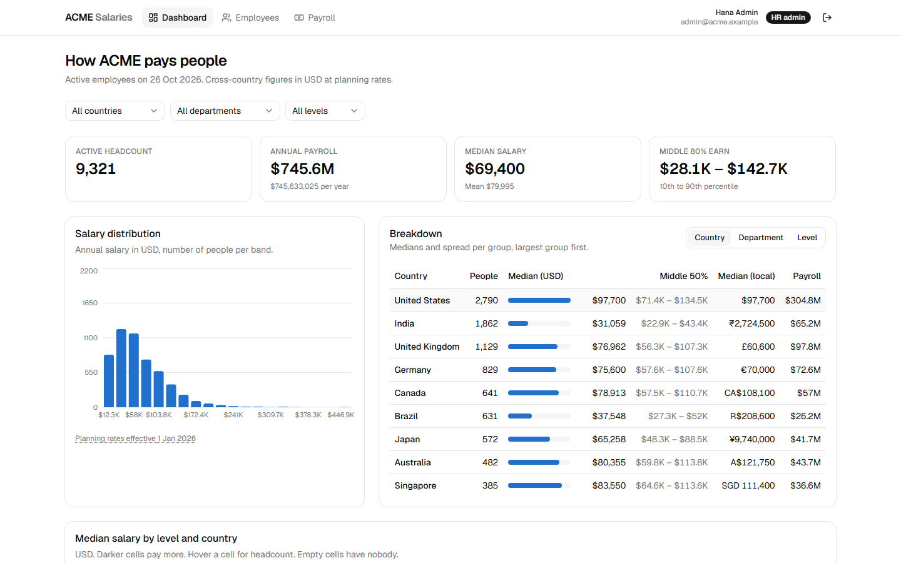
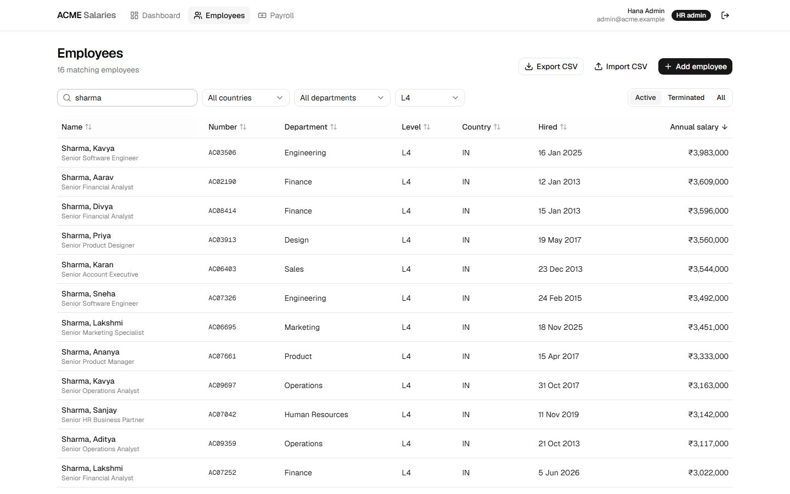
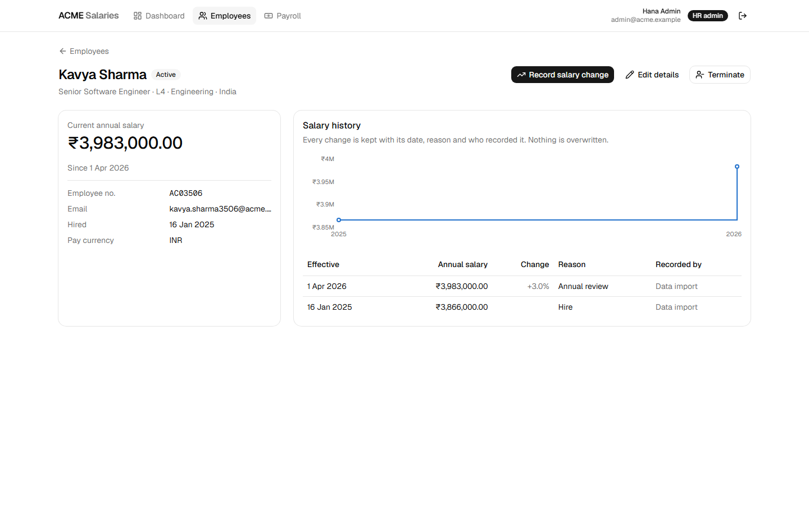
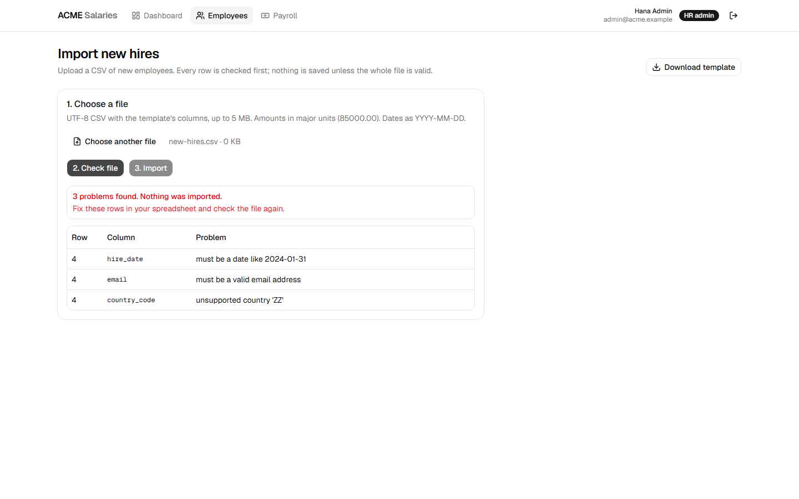
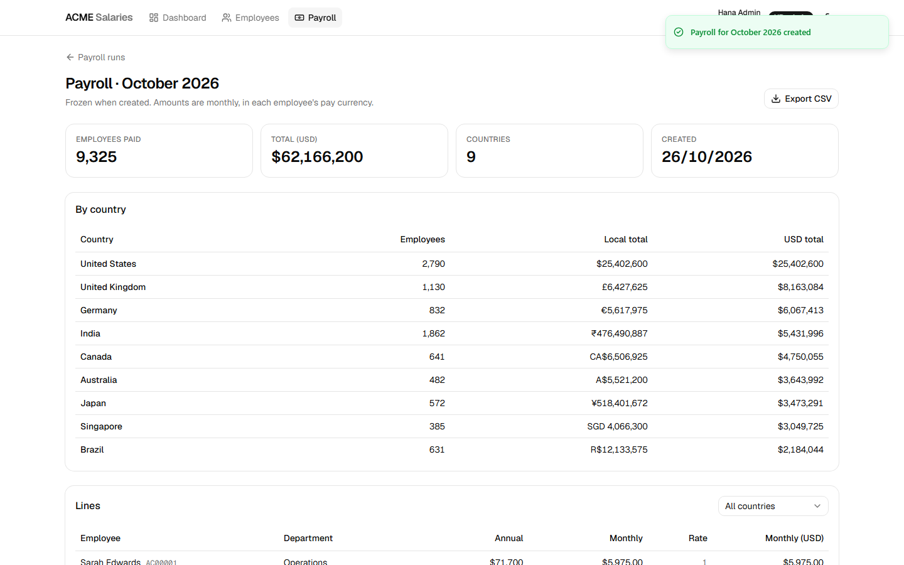

# ACME Salary Management

Web-based salary management for the HR manager of ACME, a 10,000-employee organization paying
people in nine countries. It replaces spreadsheets with a system that keeps a full salary
history, answers "how do we pay people?" in one currency, imports and exports CSV, and records
monthly payroll runs.

| | |
|---|---|
| **Live app** | _add the Vercel URL after deploying (see [docs/deployment.md](docs/deployment.md))_ |
| **API docs** | _add `https://<api>.fly.dev/docs` after deploying_ |
| **Demo video** | [docs/demo/walkthrough.webm](docs/demo/walkthrough.webm), a captioned 1-minute walkthrough |
| **Demo logins** | `admin@acme.example` (HR admin) · `viewer@acme.example` (read only) · password `acme-demo-2026` |



## Read this first

| Document | What it covers |
|---|---|
| [docs/requirements.md](docs/requirements.md) | One-page requirements, written before any code: goal, scope, deliberate exclusions |
| [docs/architecture.md](docs/architecture.md) | System shape, data model, request flow, testing strategy (diagrams) |
| [docs/decisions/](docs/decisions/) | Nine decision records: framework, money, salary history, tenancy, SQLite, rates, auth, payroll, CSV |
| [docs/ai-usage.md](docs/ai-usage.md) | How AI tools were used, the prompts, and what was caught and fixed by hand |
| [docs/performance.md](docs/performance.md) | Measured timings on 10,000 employees and the trade-offs behind them |
| [docs/deployment.md](docs/deployment.md) | Deploying the API to Fly.io and the web app to Vercel |

## What the HR manager can do

- **See how the org pays people.** Headcount, payroll, median and percentile spread in USD,
  sliced by country, department and level. A level-by-country median heatmap, and local
  currency next to USD.
- **Manage salary data with history.** Search, filter, and sort 10,000 employees. Every salary
  change is a dated event with a reason and author, and nothing is overwritten. Raises can be
  scheduled ahead.
- **Add, edit, terminate, and reactivate employees.** Optimistic locking stops two people
  from silently overwriting each other.
- **Import new hires from CSV** all or nothing, with every bad row reported first.
  **Export** any filtered view.
- **Run monthly payroll** as a frozen record with per-country totals in local currency and USD.
- **Two roles.** HR admin can change data. HR viewer is read only, enforced by the API.

| | |
|---|---|
|  |  |
|  |  |

## Stack

| Layer | Choice |
|---|---|
| API | Python 3.11, FastAPI, SQLAlchemy 2, Alembic, Pydantic 2 |
| Database | SQLite (WAL) with integer money in minor units |
| Web | Next.js 16 (JavaScript), Tailwind 4, shadcn/ui, Recharts |
| Tests | pytest (220), Vitest + Testing Library (28), Playwright walkthrough (9 journeys) |
| Delivery | Docker, Fly.io (API), Vercel (web), GitHub Actions CI |

## Run it locally

```bash
# API: http://localhost:8000/docs
cd apps/api
python -m venv .venv && .venv/Scripts/activate      # macOS/Linux: source .venv/bin/activate
pip install -e ".[dev]"
alembic upgrade head
python -m app.seed                                   # 10,000 employees in about 2 seconds
uvicorn app.main:app --reload

# Web: http://localhost:3000  (second terminal)
cd apps/web
npm install
cp .env.example .env.local
npm run dev
```

Or run the API in Docker. It migrates and seeds on first boot:

```bash
docker build -t acme-api apps/api
docker run -p 8000:8000 -e ACME_JWT_SECRET=dev-secret-dev-secret-dev-secret-123 acme-api
```

## Tests

```bash
cd apps/api && pytest            # 220 tests, a few seconds, in-memory SQLite, fixed clock
cd apps/web && npm test          # 28 tests, jsdom, no network
# End-to-end against running servers (see the script header):
node apps/web/e2e/walkthrough.mjs --web http://localhost:3000
```

## Repository layout

```
apps/api     FastAPI backend: domain/ (pure rules) -> services/ -> api/, plus seed and migrations
apps/web     Next.js frontend: app/ routes, components/ by feature, lib/ for API and formatting
docs         requirements, architecture, decisions, AI usage, performance, deployment, media
```

The commit history is meant to be read in order. It starts with requirements and decision
records, then builds the domain layer, API, seed, analytics, CSV, payroll, deployment, and UI,
each with its tests.
