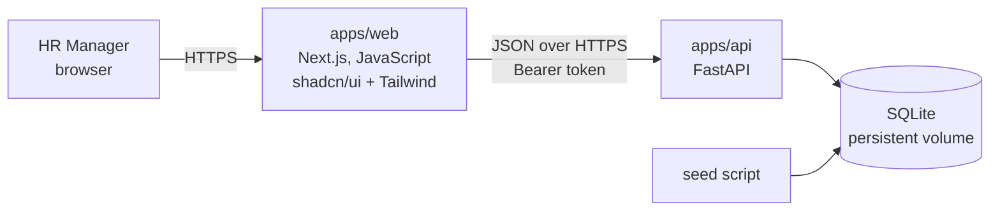
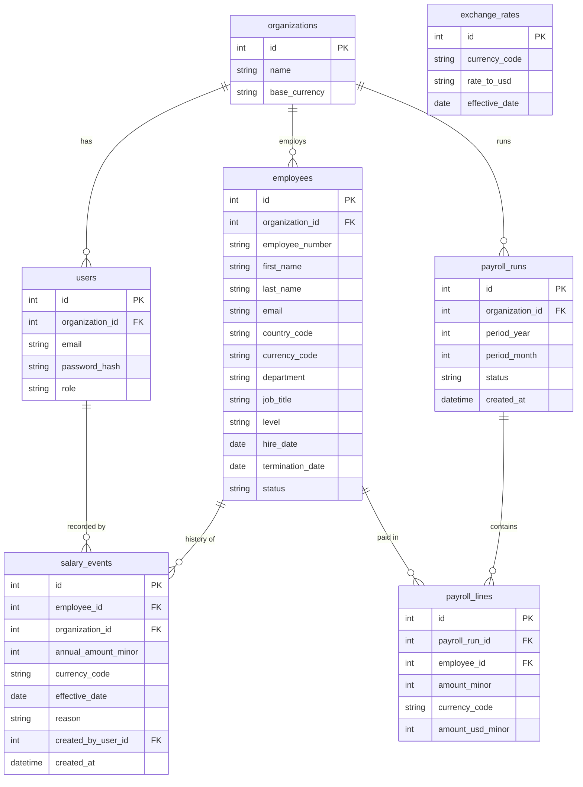

# Architecture

## Shape

Two deployable apps in one repository, talking over a small JSON API.



The frontend is a thin client. It holds no business rules: forms send what the user typed and show the API's field errors next to each input. Every aggregate, conversion, and permission check happens in the backend so it can be unit tested without a browser.

## Backend layers

```
apps/api/app/
  domain/        pure Python: money, salary history rules, CSV row validation, statistics
  models/        SQLAlchemy tables
  repositories/  queries, always scoped by organization_id
  services/      use cases: employees, salary changes, analytics, payroll, import/export, auth
  api/           FastAPI routers, request/response schemas (Pydantic), dependency wiring
  seed/          deterministic 10,000-employee generator
```

Dependencies point inward: `api -> services -> repositories/domain -> models`. The `domain` package imports nothing from the web or database layers, so most unit tests are plain function calls with no fixtures.

## Data model



Key points:

- **Current salary is derived.** `employees` has no salary column. The current salary is the `salary_events` row with the latest `effective_date` on or before today. An index on `(employee_id, effective_date)` makes this one index seek per employee. The list endpoint pages employee IDs first, then resolves current salary for just that page (see performance.md).
- **Money is integers.** `annual_amount_minor` is in the currency's minor unit (cents, pence, or whole yen). The currency's exponent comes from a small ISO 4217 table in `domain/money.py`.
- **Rates are strings.** `rate_to_usd` is stored as a decimal string and parsed with `Decimal`. Floats never touch money.
- **Everything tenant-owned carries `organization_id`.** Repositories take the organization from the authenticated user, never from the request body.
- **Payroll lines are frozen.** A run copies the amounts at generation time. Later salary changes do not alter a past run.

## Request flow

1. The frontend sends `Authorization: Bearer <token>`.
2. A FastAPI dependency decodes the token, loads the user, and yields a `CurrentUser` with `organization_id` and `role`.
3. Routers that mutate data depend on `require_role("hr_admin")`.
4. Services receive the `CurrentUser`, call repositories scoped to that organization, and apply domain rules.
5. Domain rule failures raise typed exceptions that an exception handler maps to `422` with a structured body the UI can render next to the right field.

## Testing strategy

| Layer | How | Why |
|---|---|---|
| `domain` | Plain pytest, no fixtures | Fast, exhaustive edge cases on money, dates, validation |
| `services` + `repositories` | Exercised through the API tests and the seed tests, in-memory SQLite per test, injected clock | Deterministic, no shared state |
| `api` | FastAPI `TestClient` against in-memory SQLite | Verifies auth, roles, status codes, response shape |
| Analytics | Small hand-built fixture with known answers | Percentiles and conversions verified against values computed by hand |
| Frontend | Vitest: formatting, URL state, API error mapping, data loading, table and import components | Rendering logic only; rules live in the API |
| End to end | Playwright walkthrough (`apps/web/e2e/walkthrough.mjs`) against a production build and the real API | Proves the screens work together; also records the demo video and screenshots |

The clock is injected everywhere a date matters, so "current salary" and "active today" never depend on the wall clock.

## Deployment

- `apps/api` runs as a Docker container on Render's free plan. The free plan has no persistent disk, so the container re-seeds the demo data on every boot (see ADR 005). One machine is enough for 10,000 rows and a single HR team; SQLite in WAL mode handles concurrent reads with one writer.
- `apps/web` runs on Vercel and points at the API URL via an environment variable.
- CI runs backend lint, tests, a migrations-vs-models check and a Docker build, plus frontend lint, tests and a production build, on every push.
- Step-by-step instructions: [deployment.md](deployment.md).

See `docs/decisions/` for the reasoning behind each major choice.
