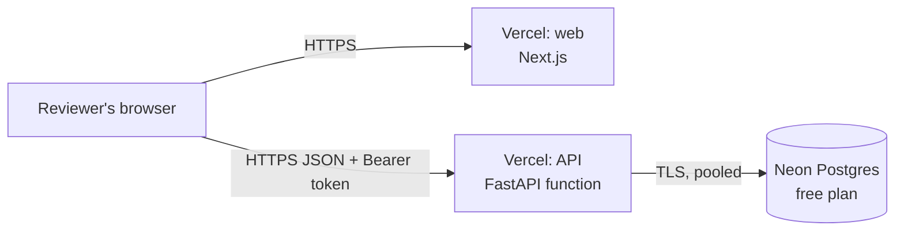

# Deployment

The live demo runs entirely on free plans that need no payment card:

| Piece | Where | Notes |
|---|---|---|
| Web (`apps/web`) | Vercel project 1 | Next.js, root directory `apps/web` |
| API (`apps/api`) | Vercel project 2 | FastAPI on Vercel's Python runtime, entry point `apps/api/index.py` |
| Database | Neon free Postgres | Region AWS US East, next to Vercel's default functions region |



## Why this setup

- **No card anywhere.** Render, Fly.io and Railway all asked for a card or offer only a
  trial. Vercel Hobby and Neon Free do not.
- **Data persists and is shared.** A serverless function cannot keep a SQLite file, so
  production uses Postgres. Code, tests and migrations are the same; SQLAlchemy handles
  the difference. CI runs the whole API suite on both SQLite and Postgres.
- **No sleeping server.** A cold function starts in a second or two, and Neon resumes a
  suspended database in under a second. That beats a free container that takes about a
  minute to wake.
- Locally and in Docker the app still uses SQLite (ADR 005); only the connection string
  changes.

## 1. Database on Neon

1. Sign up at [neon.tech](https://neon.tech) with GitHub. Create project `acme-salary`,
   Postgres 17, region **AWS US East (N. Virginia)**.
2. **Connect** → copy the **pooled** connection string (`postgresql://…-pooler…`).
3. Create the tables and load the demo data from a machine with the repository:

```bash
cd apps/api
pip install -e ".[dev]"
# PowerShell: $env:ACME_DATABASE_URL="postgresql://..."
export ACME_DATABASE_URL="postgresql://..."
alembic upgrade head
python -m app.seed            # 10,000 employees; several minutes over the network (about 6 measured)
```

## 2. API on Vercel

1. [vercel.com](https://vercel.com) → **Add New → Project** → import
   `acme-salary-management`.
2. **Project name:** `acme-salary-api`. **Root Directory:** `apps/api`. Framework is
   detected as FastAPI (or choose "Other").
3. **Environment variables:**

| Name | Value |
|---|---|
| `ACME_ENVIRONMENT` | `production` |
| `ACME_DATABASE_URL` | the Neon pooled connection string |
| `ACME_JWT_SECRET` | 48+ random characters (`python -c "import secrets; print(secrets.token_urlsafe(48))"`) |
| `ACME_CORS_ORIGINS` | `["http://localhost:3000"]` for now; corrected in step 4 |

4. **Deploy**. Check `https://acme-salary-api.vercel.app/health` returns
   `{"status":"ok"}` and `/docs` shows the API.

## 3. Web on Vercel

1. **Add New → Project** → import the same repository again.
2. **Project name:** `acme-salary-management`. **Root Directory:** `apps/web`.
3. **Environment variable:** `NEXT_PUBLIC_API_URL` = the API URL from step 2, no trailing
   slash.
4. **Deploy**, and note the URL.

## 4. Connect them

In the API project → **Settings → Environment Variables**, set `ACME_CORS_ORIGINS` to
the exact web URL, then **Deployments → Redeploy**:

```
["https://acme-salary-management.vercel.app"]
```

## Things that commonly break

| Symptom | Cause | Fix |
|---|---|---|
| Login does nothing; console shows a CORS error | `ACME_CORS_ORIGINS` does not exactly match the web URL | Fix it in the API project, then redeploy the API |
| The web app calls the old API URL | `NEXT_PUBLIC_API_URL` is fixed at build time | Change it, then redeploy the web project |
| API returns 500 on every call | `ACME_DATABASE_URL` missing or wrong, or tables not created | Check the variable; run `alembic upgrade head` against Neon |
| API fails at start mentioning `ACME_JWT_SECRET` | Missing or shorter than 32 bytes | Set a longer secret and redeploy |
| Large CSV import fails | Vercel limits request bodies to 4.5 MB | The app rejects files over 4 MB with a clear message; split the file |
| Works on the production URL, not a preview URL | Preview URLs are not in the CORS list | Test on the production URL |

## Reset the demo data

Run against Neon from the repository: `python -m app.seed --reset`.

## Other ways to run it

- **Any Docker host** (Render, Fly.io, a VPS): `apps/api/Dockerfile` migrates, seeds an
  empty SQLite file and serves. Mount a disk at `/data` to keep data. `fly.toml` is
  included for Fly.io.
- **Docker with Postgres:** pass `ACME_DATABASE_URL=postgresql://…` to the same image.

## Checklist after deploying

- [ ] API `/health` returns ok
- [ ] Log in at the web URL as `admin@acme.example` and `viewer@acme.example`
- [ ] Dashboard shows 9,321 active employees
- [ ] Run the smoke test in [testing-guide.md](testing-guide.md#15-ten-minute-smoke-test-run-after-every-deploy)
- [ ] Put both URLs in the table at the top of the README
- [ ] Reset the demo data so reviewers start clean
