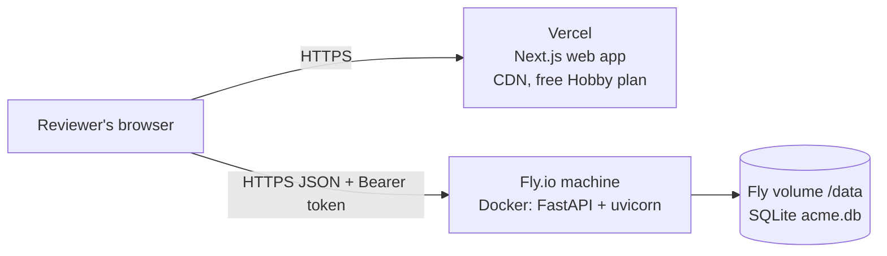

# Deployment

Two pieces, deployed separately (ADR 005):

| Piece | Where | Why |
|---|---|---|
| API (`apps/api`) | Fly.io, one machine, SQLite on a persistent volume | Docker image already verified locally; volume keeps data across restarts |
| Web (`apps/web`) | Vercel | Native Next.js host; one environment variable |

The container migrates and seeds on first boot, so a fresh deploy comes up with the 10,000
employee demo organization and the two demo logins. A restart skips seeding.

## Recommendation and reasoning



**What actually has to run**

| Component | Needs | Recommended | Rough cost |
|---|---|---|---|
| Web (Next.js) | A Node/Next host with a CDN | **Vercel**, made by the Next.js team, deploys from GitHub on every push | Free (Hobby) |
| API (FastAPI) | Runs a Docker container 24/7 | **Fly.io**, one `shared-cpu-1x`, 512 MB machine | A few dollars a month (needs a card on file; check current pricing) |
| Database (SQLite) | A **persistent disk** attached to the one API machine | **Fly volume**, 1 GB | Cents a month |
| Secrets | JWT secret, demo password, allowed origin | `fly secrets` and Vercel env vars | Free |

**Why this pair**

- SQLite (ADR 005) needs a real disk and exactly one writer. Fly gives a volume pinned to one
  machine, which fits that exactly. Most free hosts have ephemeral disks: the data would
  reset on every restart, and reviewers might see edits vanish mid-review.
- The API is already a verified Docker image, so Fly runs exactly what was tested locally.
- Vercel needs no configuration for Next.js beyond the root folder and one variable.
- No managed database to provision or pay for. One file holds all the data, and backup is
  copying that file.

**Settings that matter for reviewers**

- `min_machines_running = 1` in `fly.toml` keeps the API warm. Without it, the first request
  after idle waits a few seconds for the machine to boot. You can set it back to 0 after the
  review to save money.
- `primary_region`: `lhr` (London) is the default here. Pick the region closest to the
  reviewers, e.g. `iad` for the US east coast or `sin` for Singapore, before first deploy. A
  volume cannot move regions.
- **Two settings must match exactly.** `NEXT_PUBLIC_API_URL` on Vercel must equal the Fly URL.
  `ACME_CORS_ORIGINS` on Fly must equal the Vercel production URL, with `https://` and no
  trailing slash. Most "login does nothing" problems are a CORS mismatch. Check the browser
  console.
- `NEXT_PUBLIC_API_URL` is baked in at **build** time. After changing it, redeploy on Vercel.
- Vercel **preview** URLs (per-branch) differ from production and are not in the CORS list.
  Test on the production URL.

**Alternatives if you can't use Fly**

| Option | Trade-off |
|---|---|
| Render web service + persistent disk | Same Dockerfile; the disk needs a paid instance. Free instances sleep and lose data. |
| Railway with a volume | Same Dockerfile; trial credit, then usage-based. |
| Any free host without a disk | Works, but re-seeds on every restart. Say so in the README. |
| Everything on one VPS (Docker Compose) | Cheapest long term, but you manage TLS and updates. Not worth it for an assessment. |

## 1. API on Fly.io

```bash
# once
curl -L https://fly.io/install.sh | sh      # Windows: iwr https://fly.io/install.ps1 -useb | iex
fly auth signup                             # or: fly auth login

cd apps/api
# edit fly.toml: set `app` to a unique name, e.g. acme-salary-api-<you>
fly launch --copy-config --no-deploy
fly volumes create acme_data --size 1 --region lhr
fly secrets set \
  ACME_JWT_SECRET="$(python -c 'import secrets; print(secrets.token_urlsafe(48))')" \
  ACME_DEMO_PASSWORD="acme-demo-2026"
fly deploy
curl https://<app>.fly.dev/health           # {"status":"ok"}
```

The API refuses to start in production without a real `ACME_JWT_SECRET` (32+ bytes).

## 2. Web on Vercel

1. Push the repository to GitHub.
2. In Vercel: **Add New → Project → Import** the repository.
3. **Root Directory:** `apps/web`. Framework preset: Next.js (detected).
4. **Environment variable:** `NEXT_PUBLIC_API_URL = https://<app>.fly.dev`
5. Deploy. Note the URL, e.g. `https://acme-salaries.vercel.app`.

## 3. Allow the web origin on the API

```bash
cd apps/api
fly secrets set ACME_CORS_ORIGINS='["https://acme-salaries.vercel.app"]'
```

Setting a secret restarts the machine. Log in at the Vercel URL with the demo accounts in
the README.

## Alternatives

- **Render / Railway:** both build `apps/api/Dockerfile` as is. Mount a disk at `/data`. On a
  free plan without a disk, the database re-seeds on every restart. That is acceptable for a
  demo, but changes will not persist.
- **Reset the demo data:** `fly ssh console -C "python -m app.seed --reset"`.

## Checklist after deploying

- [ ] `GET /health` returns ok
- [ ] Login works for `admin@acme.example` and `viewer@acme.example`
- [ ] Dashboard shows 9,321 active employees
- [ ] Run the walkthrough against production:
      `node apps/web/e2e/walkthrough.mjs --web https://<vercel-url>`
      (it creates test data; run `--reset` seeding afterwards if you want a clean demo)
