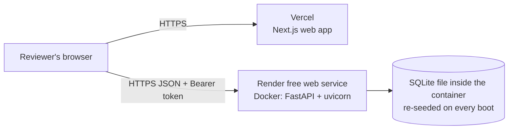

# Deployment

The live demo runs on two free services:

| Piece | Where | Config |
|---|---|---|
| API (`apps/api`) | Render free web service, Docker | [`render.yaml`](../render.yaml) |
| Web (`apps/web`) | Vercel Hobby | Root directory `apps/web`, one environment variable |



## Why these two

- **Free, no card.** Both have free plans that run this app without payment details.
- **Vercel** is made by the Next.js team. It needs only the root folder and the API URL.
- **Render** builds the API's existing Dockerfile unchanged, so production runs the same
  image that was tested locally.

## What the free API plan means

| Limit | Effect | Why it is acceptable |
|---|---|---|
| No persistent disk | The SQLite file is lost on redeploy, restart or sleep. | The container migrates and seeds 10,000 employees on every boot, so it always starts from clean demo data. Reviewers' edits do not survive a restart. |
| Sleeps after 15 minutes idle | The first request after a sleep waits about a minute. | A free uptime monitor calling `/health` every 10 minutes keeps it awake. One service running all month fits in the 750 free hours. |
| Small CPU share | Requests that take under 100 ms locally may take about a second. | Fine for a demo. |

For lasting data, the same Dockerfile runs on a paid plan with a disk. The Render
Starter plan or Fly.io with a volume both work; set `ACME_DATABASE_URL` to a file on the
mounted disk. ADR 005 explains why SQLite on one machine fits this workload.

## 1. API on Render

1. Sign in at [render.com](https://render.com) with GitHub and allow access to
   `acme-salary-management`.
2. **New → Blueprint**, pick the repository. Render reads `render.yaml` and proposes the
   `acme-salary-api` service on the Free plan.
3. When asked for `ACME_CORS_ORIGINS`, enter `["http://localhost:3000"]` for now. It is
   corrected in step 3 below.
4. **Apply.** The first build takes a few minutes. When it is live, note the URL, e.g.
   `https://acme-salary-api.onrender.com`.
5. Check `https://<api>.onrender.com/health` returns `{"status":"ok"}` and
   `https://<api>.onrender.com/docs` shows the API.

`ACME_JWT_SECRET` is generated by Render. The API refuses to start in production without
a secret of at least 32 bytes.

## 2. Web on Vercel

1. Sign in at [vercel.com](https://vercel.com) with GitHub.
2. **Add New → Project**, import `acme-salary-management`.
3. **Root Directory:** `apps/web`. Framework preset: Next.js (detected).
4. **Environment variable:** `NEXT_PUBLIC_API_URL` = the Render URL from step 1, with no
   trailing slash.
5. **Deploy**, and note the production URL, e.g. `https://acme-salary-management.vercel.app`.

## 3. Connect them

In Render, open the service, then **Environment**, and set:

```
ACME_CORS_ORIGINS = ["https://acme-salary-management.vercel.app"]
```

Use the exact Vercel production URL, with `https://` and no trailing slash. Saving
redeploys the API.

## 4. Keep the API awake (optional, recommended while reviewers are looking)

Create a free monitor at [cron-job.org](https://cron-job.org) or
[UptimeRobot](https://uptimerobot.com) that requests
`https://<api>.onrender.com/health` every 10 minutes.

## Things that commonly break

| Symptom | Cause | Fix |
|---|---|---|
| Login does nothing; browser console shows a CORS error | `ACME_CORS_ORIGINS` does not exactly match the Vercel URL | Correct it in Render; it redeploys |
| The web app still calls the old API URL | `NEXT_PUBLIC_API_URL` is fixed at build time | Change it in Vercel, then **Redeploy** |
| Works on the production URL but not a preview URL | Preview URLs are not in the CORS list | Test on the production URL |
| First page load hangs for about a minute | The API was asleep | Normal on the free plan; add the monitor from step 4 |
| API deploy fails at start with `ACME_JWT_SECRET` | The secret is missing or short | Let Render generate it, or set 32+ random characters |

## Reset the demo data

Any restart re-seeds. In Render, use **Manual Deploy → Restart service**.

## Checklist after deploying

- [ ] `https://<api>/health` returns ok
- [ ] Log in at the Vercel URL as `admin@acme.example` and `viewer@acme.example`
- [ ] Dashboard shows 9,321 active employees
- [ ] Run the smoke test in [testing-guide.md](testing-guide.md#15-ten-minute-smoke-test-run-after-every-deploy)
- [ ] Put both URLs in the table at the top of the README
- [ ] Restart the API so reviewers start from clean data
